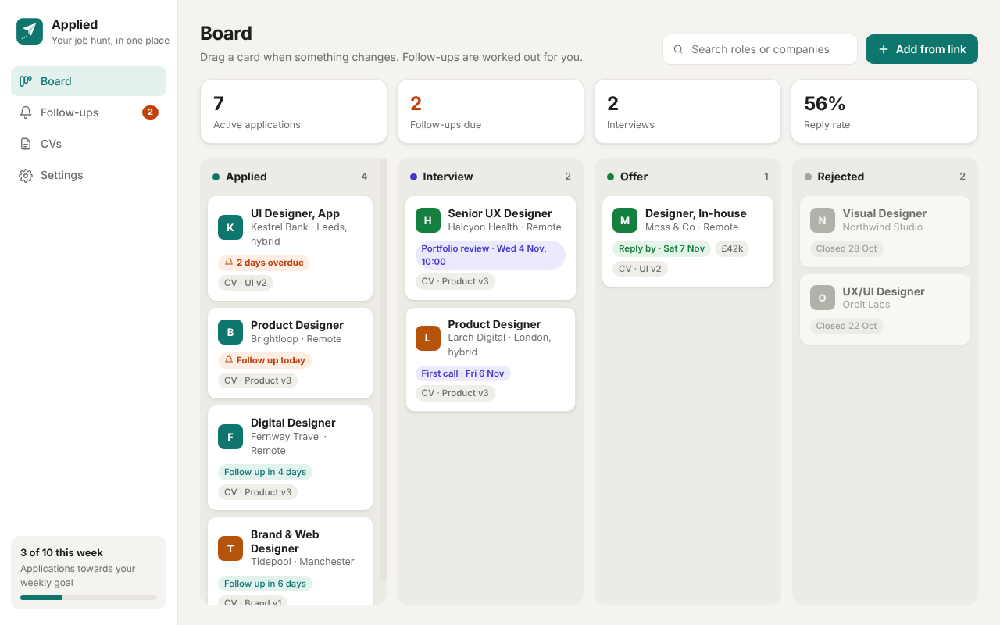

# Applied

A Windows tray app that keeps a job hunt in one place: applications on a board, a nudge when it's time to follow up, and every application linked to the CV you sent.



## What it does

- **Board.** Applied, Interview, Offer and Rejected columns. Drag a card when something changes, with undo.
- **Add from link.** Paste a job ad link and it fills in the role, company, location and salary where the page has them (most job boards publish these for Google Jobs). Anything it can't find, you type. If a link's on the clipboard when you click Add, it's used straight away.
- **Follow-ups.** Each application gets a follow-up date, 7 days after applying by default (3, 14 or any date per application). A daily reminder pops up at 9am, or as soon as the PC's on after that. The Follow-ups page lists what's due, with Snooze 3 days and Done.
- **CVs.** Pick the CV you sent from your CV folder (`Documents\CVs` by default). The CVs page shows how many times each was sent and how many got a reply. Name files like `Your Name CV – Product v3.pdf` and the bit after the dash becomes the label.
- **Numbers.** Active applications, follow-ups due, interviews, reply rate, and a weekly goal in the sidebar.
- **Dark mode** follows Windows, or set Light or Dark in Settings.
- Lives in the tray, can start with Windows, and updates itself from GitHub Releases.

Everything is stored on your PC in `%APPDATA%\applied\applied.json`. Nothing is sent anywhere apart from fetching the job ad you paste.

## Run it

```
npm install
npm start
```

## Test

```
npm test
```

## Release

Bump `version` in `package.json`, merge, then push a matching tag:

```
git tag v0.1.0
git push origin v0.1.0
```

`.github/workflows/release.yml` builds the installer and portable exe and publishes them to GitHub Releases. Installed copies pick up new releases automatically.

## Icons

The logo is `assets/icon.svg` (with `icon-small.svg` for tray sizes). After changing either, run `npm run icons` (needs Playwright) to rebuild the PNG and ICO files.
